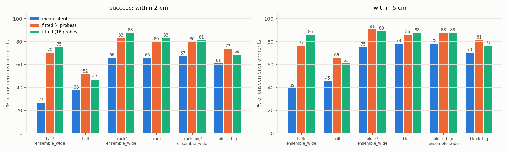
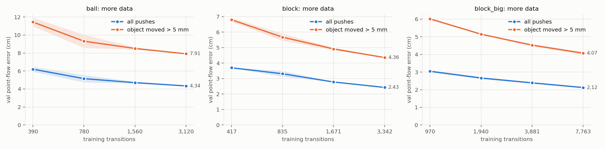
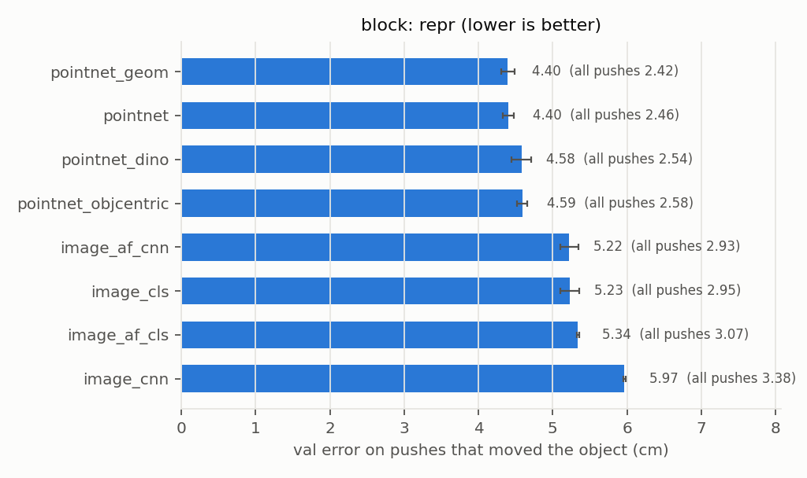

# Changes in this revision: ball task, image observations, ablations

This note summarises what changed between the initial block-push commit (`b0a13da`, the
original EC2 run of 19 Nov 2026) and the current branch, why the changes were made, and what
the new experiments show. The README describes the system as it is now; this file is the diff
and the argument. All new numbers were produced from scratch on 21–23 Nov 2026 on the CMU
`grogu` cluster (one RTX 2080 Ti per job). The full auto-generated tables are in
[`docs/results.md`](docs/results.md) and the figures in [`docs/`](docs/).

## Summary

- **A second task, the rolling ball** (`RollBallPhys-v1`), runs through the unchanged pipeline.
  Its physics (rolling resistance, not sliding friction) is a different learning problem, and
  the physics latent transfers there too: fitting it on 8 probing pushes cuts prediction error
  on unseen environments by 59% (block: 31%), and MPC success rises from 38% to 52%.
- **Image observations were added next to the point cloud** (frozen DINOv2 features, a CNN
  from scratch, and action-frame image crops) so that the representation question could be
  asked on identical data and latents. Images are 15–20% worse offline and far worse in the
  loop (block MPC 31% vs 66% with the mean latent). Putting the image into the push's action
  frame before the encoder roughly doubles the image planner's success (27–38% → 50–66%).
- **A full offline ablation suite** (encoders, architecture, latent, loss, augmentation, data
  size, representation) with SLURM launchers and auto-generated tables and figures. It ranks
  the levers as data > ensembling > width/attention, with the latent indispensable (removing
  it raises validation error by 50%).
- **Ensembles of 5 wide PointNets** are the biggest single control improvement: block final
  distance 4.1 → 2.4 cm (91% of blocks within 5 cm), ball success 52% → 70–75%.
- **A larger block dataset** (`runs/block_big`, 128 settings, 8.6k transitions) confirms the
  data-scaling trend has no plateau yet (about 10% less error per doubling).

## 1. What changed

### 1.1 A second object: the rolling ball

Everything task-dependent was pulled into one place so a new object is a config, not a fork.

- [`env/tasks.py`](env/tasks.py) (new): `TaskSpec` holds the env id, object size and shape,
  whether rotation is learned, push force/duration/height ranges, the physics-pool ranges and
  settle parameters. `TASKS = {block, ball}`; `get_task()` resolves names.
- [`env/roll_ball.py`](env/roll_ball.py) (new): `RollBallEnv(PushBlockEnv)` registers
  `RollBallPhys-v1`. It overrides only the object shape (sphere collision + visual, inertia
  2/5 m r²). To make this a one-method override, [`env/push_block.py`](env/push_block.py) gained
  an `_add_object_shape()` hook and generic `obj_half_size` / `OBJECT_NAME` attributes.
- [`env/push_primitive.py`](env/push_primitive.py): a **settle phase** after the push
  (`settle_speed`, `settle_timeout`): keep simulating until the object is slower than 1 cm/s
  (3 s timeout), so the next observation shows a ball at rest. `info["push"]` now also reports
  `settle_time` and `final_speed`. `make_push_env()` takes a `task` and applies its settle
  defaults.
- [`policy/mpc.py`](policy/mpc.py): the samplers are shape-aware. `sphere_geometry()` reads the
  ball's centre and radius off the top cap and its height; `sphere_entry()` finds where a push
  line enters the ball. `ActionSampler` and `ProbeSampler` take `shape="box"|"sphere"` and
  task-specific height ranges; `block_position()` and the planner take the object's
  `half_size`.
- [`train_dynamics.py`](train_dynamics.py): `--task ball`; the physics pool now samples linear
  and angular damping; `task_defaults()` fills force/duration/physics ranges from the task
  unless given on the command line (`parse_config()`); ground truth for tasks with
  `rotation=False` is the translation of the object's centre with R = I. Rollout stats now log
  `collided_rate` and `settle_time_s`.
- [`dynamics_model/model.py`](dynamics_model/model.py): `rotation=False` fixes the predicted
  rotation to the identity.
- `demo_push_primitive.py`, `visualize_pointcloud.py` and the new
  [`scripts/push_stats.py`](scripts/push_stats.py) take `--task`; the latter measures what random
  pushes do (contact rate, roll distance percentiles, settle time) and was used to tune the
  ball's ranges.

### 1.2 Images alongside the point cloud

- [`env/observation.py`](env/observation.py) (new): obs mode `rgb+position+segmentation` and
  `split_obs()`, which builds the point cloud with ManiSkill's own conversion and keeps the RGB
  image (224 × 224). Point and image models therefore see the same rollouts.
- [`dynamics_model/data.py`](dynamics_model/data.py): `TransitionBuffer` optionally stores the
  image of every transition (`--save-images`, on by default), keeps it on the CPU, and can
  `attach()` precomputed per-transition tensors (DINOv2 tokens, crops) so `tensors(device)`
  returns them with the rest. Datasets carry a `meta` dict (task, config).
- [`scripts/dino_features.py`](scripts/dino_features.py) (new): frozen DINOv2 ViT-S/14 tokens
  of the stored images, computed once per dataset (fp16, CLS + 16 × 16 patches).
- [`scripts/image_crops.py`](scripts/image_crops.py) (new): the image analogue of the
  action-frame point cloud. The camera is fixed and known, so each image is re-sampled on a grid
  laid out in the push's action frame on the table plane: a top-down crop centred on the
  contact point with the push pointing right. Writes 224 px crops (for DINOv2) and 96 px crops
  and world images (for the CNNs), plus a preview figure (`docs/action_frame_crops.png`).
- [`dynamics_model/inputs.py`](dynamics_model/inputs.py) (new): computes the same inputs
  online, so the evaluation scripts and the planner can run image models. World-frame inputs
  are computed once per environment; action-frame crops depend on the candidate push, so the
  planner recomputes them per chunk of candidates.

### 1.3 New encoders and model options

`DynamicsModel` grew from 4 encoders to 13, all sharing the head, the latent and the loss:

| kind | encoders |
|---|---|
| point cloud (unchanged) | `pointnet`, `pointnet_early`, `cross_attn`, `transformer` |
| point cloud, representation variants | `pointnet_geom` (+ raised flag, distance to push line, distance to contact), `pointnet_objcentric` (object-centred cloud + offset), `pointnet_dino` (PointNet + DINOv2 fusion) |
| world-frame image | `image_cls` (DINOv2 [CLS, mean patch]), `image_attn` (patch tokens + push-conditioned attention), `image_cnn` (96 px, `SmallCNN` from scratch) |
| action-frame image crop | `image_af_cls` (DINOv2), `image_af_cnn` (`SmallCNN`, mirror augmentation = vertical flip) |

Supporting changes in [`dynamics_model/model.py`](dynamics_model/model.py):

- `ENCODER_IO` declares, per encoder, which buffer key it consumes, an optional second input
  and how its batches may be augmented ("points", "flip", "none"). Training, evaluation,
  latent inference and the planner all read it instead of hard-coding `pts_in`.
- World-frame image models receive the push's world position and direction in the
  conditioning (they cannot use the action frame); action-frame crops receive the world
  direction only.
- `ResMLP`: a pre-LayerNorm residual head (`--residual`); `--feat-dim`, `--hidden`, `--layers`
  are configurable. `latent_dim=0` disables the latent for the ablation.
- `DynamicsModel.from_checkpoint()`: checkpoints now store `model_kwargs` and `task`, so every
  script rebuilds the exact architecture (old checkpoints still load).
- `Ensemble` forwards the new signature and exposes the members' input keys.

### 1.4 Training loop

- `parse_config()` layers command line over task defaults over `Config` defaults.
- `augment()` is driven by the encoder's augmentation kind: point mirroring + noise, a row
  flip for action-frame images, or nothing for world-frame inputs.
- `--data-fraction` trains on a fixed random subset of the training split (data-scaling
  ablation).
- `metrics.jsonl` is opened fresh per run (a requeued SLURM job used to append to the previous
  attempt's records); `summarize_results.py` also tolerates the old behaviour.
- The resume check compares the full `model_kwargs`, not just the encoder name.

### 1.5 Evaluation and planning

- Both evaluation scripts read the task from the checkpoint, build the right environment,
  samplers and goal distances, and work for single models, ensembles and image models
  (`eval_latent_inference.py` can now evaluate an ensemble directory too).
- `random_shooting_mpc()` takes `inputs_fn` for image-based models (horizon 1 only, since there
  is no imagined image for later steps) and the object's `half_size`.
- `eval_mpc.py` writes the task into its JSON and annotates ball videos with damping values.
- [`scripts/train_ensemble.py`](scripts/train_ensemble.py) accepts the architecture flags and
  saves self-describing member checkpoints.

### 1.6 Ablation and results tooling

- [`scripts/ablate.py`](scripts/ablate.py) (new): offline ablations on a saved dataset, same
  split and early-stopping budget, resumable `results.json` + Markdown table per group.
  Groups: `encoders`, `image_vs_pc`, `arch`, `latent_training`, `data`, `repr`, `big`.
  `scripts/compare_encoders.py` is now a thin shim onto `ablate.py --group encoders`.
- SLURM launchers: [`scripts/slurm_run.sh`](scripts/slurm_run.sh) (generic GPU job),
  [`scripts/run_ablations.sh`](scripts/run_ablations.sh) (feature precomputation, then one job
  per group) and [`scripts/run_evals.sh`](scripts/run_evals.sh) (latent inference, MPC, hard
  MPC for one checkpoint).
- [`scripts/summarize_results.py`](scripts/summarize_results.py) and
  [`scripts/plot_results.py`](scripts/plot_results.py) turn everything under `runs/` into
  `docs/results.md` and the `docs/*.png` figures. [`scripts/make_diagram.py`](scripts/make_diagram.py)
  draws the architecture figure.

### 1.7 Documentation and assets

- `README.md` was rewritten around the two tasks, with the encoder table, ablation table, the
  results section and a gotchas list.
- `docs/`: 14 ablation bar charts, data-scaling, latent-inference and MPC figures, the
  architecture diagram, the action-frame crop preview and the generated `results.md`.
- `demos/block_push_v1/` and `demos/roll_ball_v1/`: MPC on 64 unseen environments with the
  fitted latent; `demos/roll_ball_v0/`: random pushes on the ball. `env/examples/`: what the
  camera and the model see for the ball.

## 2. Why these changes matter

**The latent is about physics, not about cubes.** The original result showed that a latent
fitted from a few pushes helps push a block. A sceptic could attribute that to the model
memorising block-specific quirks. The ball changes the object, the dominant physical
parameter (rolling resistance instead of sliding friction), the motion model (translation
only) and the data distribution (longer, impulse-driven moves), and the same code gives the
same qualitative result with a larger effect. That is the generality claim the project needed.

**Representation is the largest effect in the study, so it had to be measured properly.**
Comparing a point-cloud model to an image model trained on different data would prove
nothing. Storing the image of every transition, precomputing DINOv2 features and routing all
inputs through `ENCODER_IO` means every representation sees identical transitions, latents,
loss and budget. The action-frame image crops are the key control: they give an image the
same equivariance the action frame gives the point cloud, which separates "images lack
information" from "images are in the wrong frame". The answer is both, in measurable
proportions (section 3.5).

**Knowing which lever to pull.** Before the ablations it was unclear whether to spend effort
on attention encoders, bigger heads, a different loss or more data. The ablations settle it on
this problem: encoders and heads are within seed noise, the relative loss hurts, data scales
cleanly, and ensembling converts better prediction into better control. The big block run was
collected because the scaling curve said it would help.

**Reproducibility.** Every number in the README now comes from a JSON file produced by a
script in this repo, run from scratch on a cluster, with the launcher that produced it checked
in. Checkpoints describe their own architecture and task, so any of them can be evaluated with
one command.

## 3. Results

Unseen-physics evaluations use 64 environments drawn with a seed never used in training. With
64 environments a success rate has a standard error of about ±6 points, so differences of
that size are noise.

### 3.1 Training runs

| run | task | settings | rollouts | transitions | val error (cm) | on pushes that moved (cm) | no-motion baseline (cm) | wall time |
|---|---|---|---|---|---|---|---|---|
| `runs/block` | block | 64 | 24 | 3734 | 2.72 | 4.71 | 5.80 | 44 min |
| `runs/ball` | ball | 64 | 24 | 3478 | 4.46 | 8.03 | 8.13 | 40 min |
| `runs/block_big` | block | 128 | 56 | 8642 | 2.34 | 4.44 | 5.09 | 1.7 h |

### 3.2 Test-time adaptation of the latent (`eval_latent_inference.py`)

Prediction error (cm) on held-out pushes that moved the object, unseen environments:

| task | mean latent | fitted on 1 | 2 | 4 | 8 | oracle |
|---|---|---|---|---|---|---|
| block | 5.28 | 4.47 | 4.32 | 4.02 | 3.64 | 2.15–2.61 |
| ball | 6.90 | 4.73 | 4.27 | 3.68 | 2.82 | 1.68–2.12 |

Eight probes cut the error by 31% (block) and 59% (ball). A model with no latent at all
(`latent0`) is far worse on the validation split: block 2.46 → 3.71 cm, ball 4.31 → 6.60 cm.
A 16-d latent is no better than 8-d.


### 3.3 Goal reaching with MPC (`eval_mpc.py`)

64 unseen environments, goal 16–18 cm away, up to 10 pushes, success = within 2 cm:

| model | latent | success | within 5 cm | final dist mean / median (cm) | off table |
|---|---|---|---|---|---|
| block, PointNet (`runs/block`) | mean | 66% | 78% | 5.0 / 1.8 | 2% |
| | fitted (4 probes) | **80%** | 86% | 4.1 / 1.4 | 2% |
| | fitted (16 probes) | **83%** | 88% | 4.4 / 1.4 | 2% |
| ball, PointNet (`runs/ball`) | mean | 38% | 45% | 10.7 / 4.6 | 9% |
| | fitted (4 probes) | **52%** | 66% | 7.7 / 2.0 | 6% |
| | fitted (16 probes) | 47% | 61% | 10.3 / 1.9 | 9% |

Hard setting (goal 15–30 cm, only 2 pushes): block 17% → 41% → 36%, ball 5% → 22% → 14%
(mean / fitted 4 / fitted 16). On the ball, 16 probes are not better than 4, most likely
because later probes find the ball far from the middle of the table and are shorter, less
informative pushes.

For reference, the original EC2 block run reported 75% / 83% / 86% in the same protocol. The
re-run from scratch with this revision's code lands at 66% / 80% / 83%, within the ±6 point
sampling noise of the earlier numbers.



### 3.4 Ensembles and more data

Same probes, goals and starts, 64 unseen block environments, 10 pushes:

| block model | data | adapted error, 8 probes (cm) | success mean / fitted / fitted 16 | within 5 cm (fitted) | final dist (fitted, cm) |
|---|---|---|---|---|---|
| PointNet (`runs/block`) | 3.7k | 3.64 | 66 / 80 / 83% | 86% | 4.1 |
| wide PointNet | 3.7k | 2.44 | 56 / 78 / 78% | 83% | 3.0 |
| ensemble of 5 wide PointNets | 3.7k | 3.52 | 66 / **83** / **88%** | **91%** | **2.4** |
| PointNet, big data (`runs/block_big`) | 8.6k | 3.87 | 61 / 73 / 69% | 81% | 3.7 |
| ensemble of 5 wide PointNets, big data | 8.6k | **2.22** | 67 / 80 / 81% | 88% | **2.3** |

On the ball the ensemble is the largest single improvement of the study: success 52% → **70%**
with 4 probes and 47% → **75%** with 16, within 5 cm 66% → 86%, final distance 7.7 → 3.5 cm,
and no balls knocked off the table with the 16-probe latent. A single model's confident
mistakes on the planner's wilder candidates are what sends balls off the table; averaging
five models removes most of them.

Data scaling (validation error on pushes that moved, cm, 2 seeds):

| training transitions | 12.5% | 25% | 50% | 100% |
|---|---|---|---|---|
| block (3342 = 100%) | 6.80 | 5.68 | 4.91 | 4.36 |
| ball (3120 = 100%) | 11.44 | 9.31 | 8.51 | 7.91 |
| block_big (7763 = 100%) | 6.02 | 5.15 | 4.52 | 4.07 |

Every doubling cuts the error by 8–15% with no plateau at 7.8k transitions. The big dataset's
single PointNet is nevertheless no better than the baseline on unseen environments (within
noise); its ensemble has the lowest adapted error (2.22 cm) and the lowest final distance, and
does best on the hard setting (42% / 72% success / within 5 cm with 4 probes vs 41% / 66% for
the baseline).



### 3.5 Image features vs point cloud, and the action frame

Offline, same transitions and latents (validation error on pushes that moved, cm, 2 seeds):

| observation | block | ball |
|---|---|---|
| action-frame point cloud (`pointnet`) | **4.40** | **7.92** |
| point cloud without mirror augmentation (`no_mirror`) | 4.91 | 8.27 |
| world-frame image, frozen DINOv2 (`image_cls`) | 5.30 | 8.94 |
| DINOv2 patches + attention (`image_attn`) | 5.63 | 8.97 |

Images are 15–20% worse offline (half of that gap is the mirror augmentation only the point
cloud affords). In the loop the gap is much larger, because the planner scores 1024 candidates
per step, most of them pushes the data never contained, and the image model extrapolates to
them badly:

| block model | offline error (cm) | MPC success mean / fitted / fitted 16 | within 5 cm (fitted) |
|---|---|---|---|
| action-frame point cloud | 4.40 | 66 / **80** / 83% | 86% |
| world-frame image, frozen DINOv2 (`image_cls`) | 5.23 | 31 / 27 / 41% | 50% |
| world-frame image, CNN from scratch (`image_cnn`) | 5.97 | 34 / 38 / 47% | 55% |
| **action-frame** crop, CNN (`image_af_cnn`) | 5.22 | 53 / **66** / 56% | 78% |
| **action-frame** crop, frozen DINOv2 (`image_af_cls`) | 5.34 | 59 / 50 / 64% | 64% |

Representation ablation (validation error on pushes that moved, cm):

| representation | block | ball |
|---|---|---|
| point cloud, xyz (`pointnet`) | **4.40** | 7.84 |
| + geometric per-point features (`pointnet_geom`) | **4.40** | 7.81 |
| object-centred cloud (`pointnet_objcentric`) | 4.59 | **7.77** |
| point cloud + DINOv2 fusion (`pointnet_dino`) | 4.58 | 8.20 |
| world-frame image, DINOv2 (`image_cls`) | 5.23 | 9.15 |
| action-frame crop, DINOv2 (`image_af_cls`) | 5.34 | 9.12 |
| world-frame image, CNN (`image_cnn`) | 5.97 | 10.70 |
| action-frame crop, CNN (`image_af_cnn`) | 5.22 | 9.00 |

Three conclusions:

- **The point cloud is saturated as a representation.** Hand-made geometric features,
  object-centric coordinates and an appearance feature all land within ±0.2 cm of plain xyz.
  What limits the point model is data and contact stochasticity, not its input.
- **The action frame is worth about as much to an image as a pretrained backbone.** A CNN from
  scratch on the world-frame image is the worst model; the same CNN on the action-frame crop
  matches frozen DINOv2 offline and roughly doubles the image planner's success. Frozen DINOv2
  gains nothing from the action frame offline but does in the loop (31% → 59% with the mean
  latent).
- **No image reaches the point cloud.** The remaining gap matches the remaining offline gap,
  so it is an information gap (depth and scale from a 12-pixel object), not a frame problem.
  On the ball the image models stay at 25–34% whichever frame they use.



### 3.6 Architecture, loss and training ablations

Validation error on pushes that moved (cm, 2 seeds):

| variant | block | ball | params |
|---|---|---|---|
| `pointnet` (baseline) | 4.43 | 7.84 | 128k |
| `pointnet_early` | 4.29 | 8.04 | 129k |
| `cross_attn` | 4.60 | 7.81 | 245k |
| `transformer` | 4.74 | 7.87 | 502k |
| `pointnet_wide` | **4.23** | 8.20 | 707k |
| `pointnet_res` | 4.41 | 7.98 | 591k |
| `pointnet_res_wide` | 4.33 | **7.72** | 2.3M |
| `cross_attn_res` | 4.32 | 8.02 | 708k |

All point encoders land within ±0.2 cm of each other, within seed noise, on 3.5k transitions.
On the 8.6k-transition dataset they separate slightly (`cross_attn` and `pointnet_res_wide`
3.92 cm vs 4.07 for the plain PointNet). The relative loss hurts (block 4.43 → 6.27, ball
7.84 → 9.78 cm); a smaller learning rate and dropping the point noise change nothing.

## 4. Reproducing

```bash
# training (about 45 min each on a 2080 Ti)
python train_dynamics.py --run-dir runs/block
python train_dynamics.py --task ball --run-dir runs/ball
python train_dynamics.py --run-dir runs/block_big --pool-size 128 --init-rollouts 8 --iterations 16 --rollouts-per-iter 3

# evaluations of a checkpoint (or an ensemble directory)
scripts/run_evals.sh runs/block/checkpoint.pt

# offline ablations (features are precomputed by the launcher)
scripts/run_ablations.sh block
scripts/run_ablations.sh block repr
scripts/run_ablations.sh block_big big

# ensembles
python scripts/train_ensemble.py --dataset runs/block/dataset.pt --out runs/block/ensemble_wide --feat-dim 256 --hidden 512 --layers 4

# tables and figures
python scripts/summarize_results.py --runs runs > docs/results.md
python scripts/plot_results.py --runs runs --out docs
```

The scripts need a Linux machine with an NVIDIA GPU and Vulkan; they do not run on macOS.

## 5. Caveats and open questions

- **Sampling noise.** At 64 environments, 2 cm success rates differ by noise at the ±6 point
  level; prediction error and final distance are the more reliable guides, and they agree
  with the success rates on every ranking above.
- **Ball, 16 probes vs 4.** The 16-probe latent is not better than the 4-probe one for the
  single ball model. The probe directions point back towards the middle of the table, so later
  probes tend to be short pushes; a probe sampler that keeps the ball central would test this.
- **Image planners run at horizon 1 only.** There is no imagined image for a second step.
  Horizon 1 is also what the point-cloud planner uses, so the comparison is fair, but longer
  horizons are available only to point models.
- **One unexplained outlier.** In `docs/results.md`, `runs/block_big` with the mean latent
  reports a 43.9 cm mean prediction error in the MPC evaluation while every other entry is
  under 20 cm. The success rates of that row are ordinary; the number is likely a few runaway
  predictions and has not been investigated.
- **The big dataset's single model** is not better than the baseline on unseen environments
  despite a lower validation error; only its ensemble turns the extra data into better
  control.
