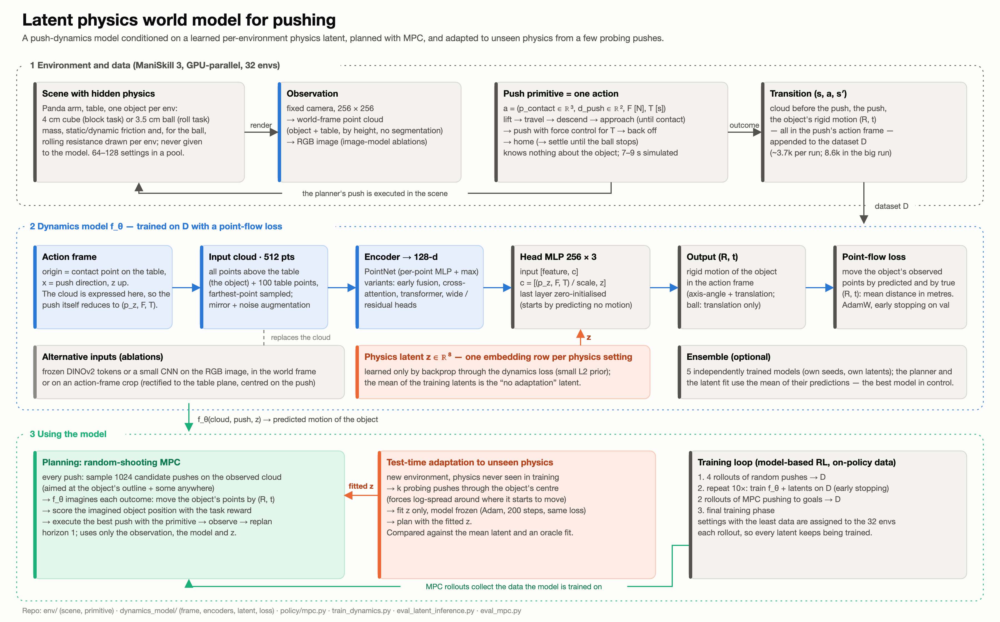
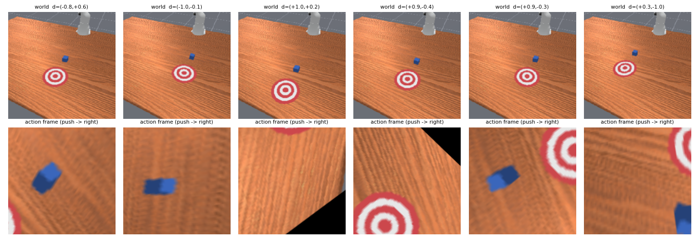
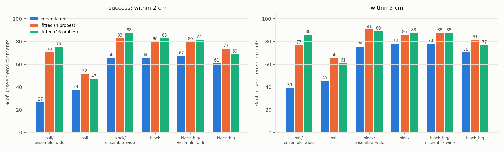
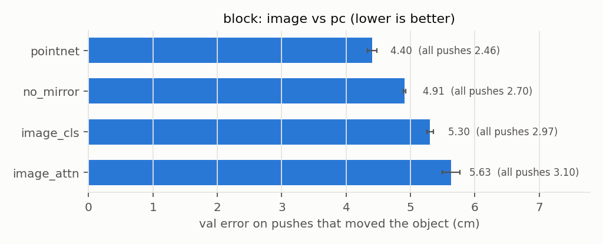
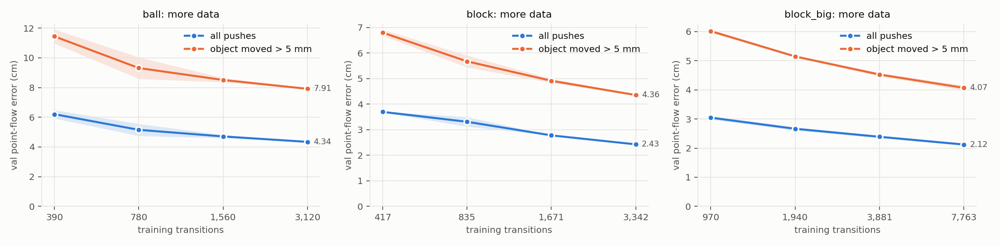
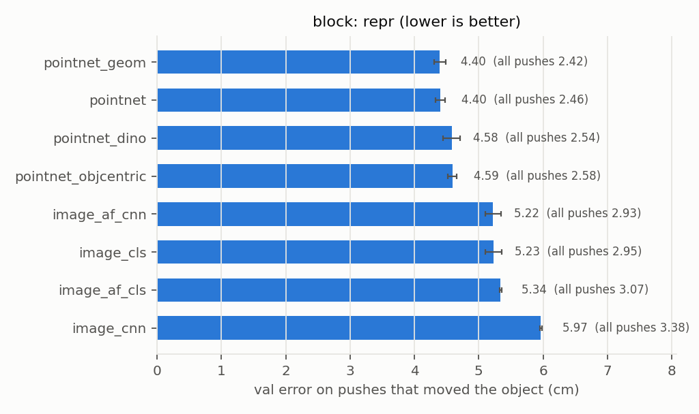

# Latent physics world model for pushing

A dynamics model for tabletop pushing that is conditioned on a learned **physics latent**: a
small vector per environment that captures the object's unobservable physical properties
(mass, friction, rolling resistance). The model predicts how a pushed object moves from a
**point cloud** observation, a **push primitive** action and the latent; a random-shooting
**MPC** uses it to push objects to goals. In a new environment the latent is fitted at test time
from a few probing pushes with the model frozen, so the same model adapts to unseen physics.

Everything runs in [ManiSkill 3](https://github.com/haosulab/ManiSkill) (SAPIEN, GPU-parallel
PhysX) with a Franka Panda. Two tasks share the whole pipeline and differ only in the object:

| task  | env id            | object                                      | learned motion    | sampled physics                                   |
|-------|-------------------|---------------------------------------------|-------------------|---------------------------------------------------|
| block | `PushBlock-v1`    | PushCube-v1's 4 cm cube                      | 6-DoF rigid motion | mass, static / dynamic friction                   |
| ball  | `RollBallPhys-v1` | RollBall-v1's ball (radius 3.5 cm)           | translation only  | mass, friction, linear + angular damping (rolling resistance) |

Contents

1. [The idea in one picture](#1-the-idea-in-one-picture)
2. [Repository layout](#2-repository-layout)
3. [Setup](#3-setup)
4. [The environment: pushing with a primitive](#4-the-environment-pushing-with-a-primitive)
5. [Observations and the action frame](#5-observations-and-the-action-frame)
6. [The dynamics model and the physics latent](#6-the-dynamics-model-and-the-physics-latent)
7. [Training loop (model-based RL with on-policy data)](#7-training-loop-model-based-rl-with-on-policy-data)
8. [Planning: random-shooting MPC](#8-planning-random-shooting-mpc)
9. [Test-time adaptation: fitting the latent](#9-test-time-adaptation-fitting-the-latent)
10. [Evaluation scripts](#10-evaluation-scripts)
11. [Ablations](#11-ablations)
12. [Results](#12-results)
13. [Gotchas and design notes](#13-gotchas-and-design-notes)

## 1. The idea in one picture



(`docs/architecture.svg` is the editable source; `python scripts/make_diagram.py` regenerates it.)

- **Data** come from executing pushes in many parallel environments, each with its own
  randomly drawn physics. A transition is (observed cloud before, push, object motion).
- **Training** fits the encoder/head and, jointly, one latent vector per physics setting, by
  backprop through a point-flow loss (how far the object's points end up from where they should).
  Nothing supervises the latents directly: they only have to make the dynamics predictable.
- **Control** is random-shooting MPC: sample candidate pushes, imagine each outcome with the
  model, execute the one whose imagined object position scores best under the task reward.
- **Adaptation**: in an unseen environment, a few probing pushes are executed; the latent (and
  only the latent) is optimised so the frozen model explains them. The fitted latent then drives
  the planner. The key experiment compares planning with the *mean* training latent (no
  adaptation) against the *fitted* latent.

## 2. Repository layout

```
env/
  push_block.py        PushBlock-v1: ManiSkill task with per-env configurable block physics
  roll_ball.py         RollBallPhys-v1: the same scene with RollBall-v1's ball (subclass)
  push_primitive.py    the push primitive (one action = one complete push) as a gym wrapper
  tasks.py             TaskSpec: everything task-dependent (object size, ranges, rotation flag)
  observation.py       obs mode that yields the point cloud AND the RGB image
  reward.py            block_reward(): the reward both the env and the planner use
  demo_push_block.py   physics sanity check (slide distance vs. analytic friction)
  demo_push_primitive.py  video of random pushes, with the camera's view (--task block|ball)
  visualize_pointcloud.py what the model sees (--task block|ball)
dynamics_model/
  geometry.py          action frame, rigid transforms, cloud preprocessing (FPS, cropping)
  model.py             encoders (point cloud, image, fusion), head, latent table, ensemble, losses
  inputs.py            image-based inputs computed online: DINOv2 tokens, action-frame crops, 96 px images
  data.py              TransitionBuffer (the replay dataset, with optional images)
  latent_inference.py  fit a latent to new data with the model frozen
  viz.py               predicted vs. true point-flow figures for TensorBoard
policy/
  mpc.py               action samplers (random policy / MPC proposals / probes) and the MPC
train_dynamics.py      Algorithm 1: collect -> train -> MPC rollouts -> ... (the main script)
eval_latent_inference.py  does fitting the latent reduce prediction error on unseen physics?
eval_mpc.py            goal reaching on unseen physics: mean vs. fitted latent, with videos
scripts/
  ablate.py            offline ablations on a saved dataset (encoders, image vs. cloud, arch, data, representations)
  dino_features.py     frozen DINOv2 features of the stored images (for the image models)
  image_crops.py       action-frame crops of the stored images (the image analogue of the action frame)
  train_ensemble.py    ensemble of models on a saved dataset
  push_stats.py        what random pushes do (for tuning a task's ranges)
  summarize_results.py / plot_results.py   Markdown tables and figures from everything under runs/
  slurm_run.sh / run_ablations.sh / run_evals.sh   SLURM launchers for the experiments below
  compare_encoders.py  old entry point, now calls ablate.py --group encoders
docs/                  figures and the full result tables (generated)
demos/                 videos: block_push_v0 (original run), block_push_v1 / roll_ball_v1 (MPC on
                       unseen physics, this revision), roll_ball_v0 (random pushes on the ball)
env/examples/          what the camera and the model see, for both tasks (png)
```

## 3. Setup

Requirements: Linux with an NVIDIA GPU. ManiSkill's GPU simulation (PhysX on CUDA) and
SAPIEN's Vulkan renderer are both needed: the point cloud comes from a rendered camera, and 32
environments are simulated in parallel. CPU simulation would be ~100x slower and the code
assumes batched tensors on the GPU. (The scripts do not run on macOS.)

```bash
conda create -n lpwm python=3.10 -y && conda activate lpwm
pip install mani_skill==3.0.1 torch torchvision tensorboard "imageio[ffmpeg]" matplotlib pillow transformers
# optional sanity checks
python -m env.demo_push_block                 # analytic slide distance vs. simulation
python -m env.demo_push_primitive --task ball # a video of random pushes -> env/examples/
python scripts/push_stats.py --task ball      # what random pushes do to the ball
```

The first run downloads the PhysX GPU library (SAPIEN) and, for the image models, the
`facebook/dinov2-small` weights. On a headless server SAPIEN needs the NVIDIA Vulkan ICD
(`/usr/share/vulkan/icd.d/nvidia_icd.json`) and `libvulkan1`; `ldconfig -p | grep vulkan` shows
whether they are there. On a SLURM cluster, `scripts/slurm_run.sh <name> <command>` submits any
of the commands below as a GPU job.

A full experiment is three commands:

```bash
python train_dynamics.py --run-dir runs/block                   # ~45 min on a 2080 Ti: data + model
python eval_latent_inference.py --checkpoint runs/block/checkpoint.pt   # ~5 min
python eval_mpc.py --checkpoint runs/block/checkpoint.pt         # ~25 min: goal reaching + videos
```

and the same with `--task ball` / `runs/ball`. TensorBoard: `tensorboard --logdir runs`. The
offline ablations and the figures of the results section:

```bash
python scripts/dino_features.py --dataset runs/block/dataset.pt          # once per dataset
python scripts/ablate.py --dataset runs/block/dataset.pt --out runs/block/ablation_data --group data --seeds 0 1
python scripts/summarize_results.py --runs runs > docs/results.md
python scripts/plot_results.py --runs runs --out docs
```

On SLURM, `scripts/run_ablations.sh block` submits every ablation group of a run as its own job
and `scripts/run_evals.sh <checkpoint>` the three evaluations of a checkpoint.

## 4. The environment: pushing with a primitive

### The scene (`env/push_block.py`, `env/roll_ball.py`)

A Panda arm at x = -0.615 m, a table whose top is z = 0, the object at a random position in
[-0.1, 0.1]² and a red/white goal disc (radius 10 cm) 20 cm in front of it (+x). A fixed camera
at (0.6, 0.25, 0.6) looks at the workspace from the far side, so the arm's home pose is behind
the workspace and never occludes the object. The image is 256 x 256; a 4 cm block is about 12
pixels wide.

Each parallel environment gets **its own object** with its own physics: PhysX fixes mass,
friction, restitution and damping when the scene is built, so these are applied at
*reconfiguration* (`env.reset(options={"reconfigure": True})`), not at every reset. The objects
of all environments are merged into one batched `Actor` (`env.obj`). `BlockPhysicsConfig`
takes a fixed value or a (low, high) range per property; `env.set_physics([...])` sets exact
values per environment (used by the training loop to assign pool settings).

The ball (`RollBallEnv`) only overrides the object shape (sphere collision + visual, inertia
2/5 m r²). What makes it a different learning problem: it keeps rolling after the gripper
lets go (so the primitive waits until it stops), its range is set by rolling resistance
(PhysX linear/angular damping) rather than sliding friction, and its rotation is unobservable.

### The push primitive (`env/push_primitive.py`)

Instead of joint commands, one action is one physically meaningful push

```
a = (p_contact ∈ R³, d_push ∈ R², F_push, T)           Box(7) per environment
```

the intended contact point in world coordinates, the push direction in the table plane, the
desired pushing force (N) and the push duration (s). `PushPrimitiveWrapper.step(a)` runs the
whole push with the arm's end-effector pose controller, for all environments at once, as a
phase machine: LIFT → TRAVEL (above a standoff point behind p_contact) → DESCEND → APPROACH
(creep along d_push until the measured contact force says the fingertips touch something) →
PUSH (PI force control on how far the commanded target leads the gripper, for T seconds, or
until contact is lost) → BACKOFF → RAISE → HOME → optionally *settle* (keep simulating until
the object is slower than `settle_speed`; the ball task uses 1 cm/s with a 3 s timeout).

The controller knows nothing about the object: if p_contact is beside it, nothing is touched
(`made_contact = False`); if p_contact is inside it, the gripper bumps it on the way down and
aborts (`collided = True`); whatever that did to the object is part of the outcome. The full
per-step trajectory, measured forces, and flags come back in `info["push"]`. A push takes
7-9 simulated seconds (350-450 control steps at 50 Hz), about 11-15 s of wall time for 32
environments on an RTX 2080 Ti.

Why a primitive: the dynamics model then predicts the *outcome of a push* (one step), the
planner searches over physically meaningful parameters, and the measured force F is a real
quantity the physics latent can relate to (a 0.1 kg block and a 1 kg block respond very
differently to 2 N for 0.5 s).

## 5. Observations and the action frame

### From camera to model input (`dynamics_model/geometry.py`, `env/observation.py`)

The env is created with obs mode `rgb+position+segmentation`; `split_obs()` converts the
position image to a world-frame point cloud with ManiSkill's own function and also keeps the
RGB image (resized to 224 x 224, for the image-feature models). From the cloud, `observed_cloud()`
builds the model input, exactly `n_in = 512` points:

1. every observed point **above the table plane** (z > 5 mm) inside the workspace box: the
   object, found from the known table height, not from segmentation;
2. then up to 100 table points spread evenly by farthest point sampling (where on the table the
   push happens);
3. remaining slots repeat object points (the encoders max-pool, so repeats change nothing).

`block_points()` uses the simulator's segmentation to pick the object's points; these are used
**only in the loss**, never as model input.

### The action frame

A push is expressed in its own frame: origin at the contact point projected on the table
(p_x, p_y, 0), x axis along d_push, z up. The cloud is transformed into this frame
(`model_input()`), so the model sees *where the object is relative to the push*, and the push
itself reduces to `act_feat = (p_z, F, T)`. The predicted motion is also in this frame and
converted back to world coordinates by `policy.mpc.predict_motion()`. This bakes translation
and rotation equivariance into the representation: the model never has to learn the same
physics for every push position and direction. (The image models cannot use this trick; see
the ablation.)

### Ground truth

The object's world pose before and after the push gives a rigid motion x' = R x + t
(`pose_change()`), expressed in the action frame (`world_transform_to_frame()`). For the ball
R is replaced by the identity and t by the displacement of its center (`TaskSpec.rotation =
False`). Transitions are dropped when the object is not visible (< 10 raised points), has too
few segmented points, or fell off the table.

## 6. The dynamics model and the physics latent

`dynamics_model/model.py`. Output: axis-angle rotation (3) and translation (3, scaled by
0.1 m) in the action frame; the last layer is zero-initialised so the model starts by predicting
"no motion". Conditioning c = [act_feat / scale, z]. Encoders (all produce a `feat_dim = 128`
feature; the head is an MLP 128 + |c| → 256 → 256 → 6, or a residual MLP with `--residual`):

| encoder          | input                                   | how c enters                          |
|------------------|-----------------------------------------|----------------------------------------|
| `pointnet`       | cloud (action frame)                    | head only (late fusion)                |
| `pointnet_early` | cloud                                   | appended to every point                |
| `cross_attn`     | cloud                                   | a query from c attends over the points |
| `transformer`    | cloud → 64 local groups → 2 attention layers | same c-query readout              |
| `image_cls`      | frozen DINOv2 ViT-S/14 [CLS, mean patch] of the RGB image | head (+ world-frame push position/direction) |
| `image_attn`     | DINOv2 patch tokens (16 x 16)           | c-query attention over the patches     |
| `pointnet_geom`  | cloud + per-point [raised, distance to the push line, distance to contact] | head |
| `pointnet_objcentric` | cloud centred on the object; its offset from the push goes to the head | head |
| `pointnet_dino`  | PointNet feature + DINOv2 feature of the world-frame image (fusion) | head |
| `image_af_cls`   | DINOv2 [CLS, mean patch] of the image rectified to the table plane and cropped into the push's action frame (`scripts/image_crops.py`) | head (+ world push direction) |
| `image_cnn`      | 96 x 96 world-frame image, small CNN trained from scratch | head (+ world push position/direction) |
| `image_af_cnn`   | 96 x 96 action-frame crop, the same CNN (mirror augmentation = vertical flip) | head (+ world push direction) |

**The latent.** `LatentTable` is an `nn.Embedding(num_settings, 8)`: one row per physics
setting in the pool, initialised near zero, trained by backprop through the dynamics loss with
a small L2 prior (1e-3) and a higher learning rate (1e-2) than the model (1e-3, AdamW). No
physics values are ever given to the model; the latent is whatever helps predict motion. The
mean of the training latents is the "no adaptation" latent used by the baselines.

**Loss.** `point_flow_loss`: the object's observed points are moved by the predicted and by the
true rigid motion; the loss is their mean distance (m). It weighs rotation and translation in
the same unit and is what "the prediction is 1.3 cm off" means everywhere in this repo.
`--loss relative` divides each push's error by how far the object moved (+ 1 cm), so small,
physics-revealing pushes count as much as long slides. Augmentation (point models): mirror
across the push direction (y → -y, with S R S and S t for the motion) and 1 mm point noise.

## 7. Training loop (model-based RL with on-policy data)

`train_dynamics.py` implements

```
pool  <- pool_size physics settings (mass log-U(0.05, 1) kg, mu_s U(0.2, 1), mu_d = mu_s U(0.5, 1);
         ball: + linear damping U(0.1, 1), angular damping U(2, 8))
D     <- init_rollouts rollouts of the random policy
repeat iterations times:
    train model + latents on D (early stopping on the val error, <= max_train_steps)
    rollouts_per_iter rollouts of the MPC policy (push the object to the goal), added to D
final training phase (<= final_train_steps)
```

A rollout runs `pushes_per_rollout = 5` pushes in `num_envs = 32` environments; before it, the
32 settings with the least data are assigned to the environments and the scene is
reconfigured, so every setting keeps its latent across rollouts and the pool is covered evenly.
The random policy (`ActionSampler`) mixes *aimed* pushes (contact point on the outline of
whatever sticks up from the table, random direction/height/force/duration) with 25% *uniform*
pushes anywhere on the workspace, so the data also contain pushes that miss. The MPC proposals
use 50% uniform. A 10% validation split (by transition) drives early stopping; the checkpoint
(`checkpoint.pt`: model, latents, config, pool), dataset (`dataset.pt`), `metrics.jsonl` and
TensorBoard logs (loss curves, rollout success, point-flow figures) land in `--run-dir`.

Default budget: 4 + 10 x 2 = 24 rollouts → ~3800 transitions; `--pool-size 128
--init-rollouts 8 --iterations 16 --rollouts-per-iter 3` gives ~9000 (the "big" run in the
results). `--resume-from` continues a run (more rollouts, `--add-settings`, or a different
model via `--init-model`).

## 8. Planning: random-shooting MPC

`policy/mpc.py`. For each environment, sample K candidate pushes with the proposal sampler on
the current observed cloud, imagine each outcome by moving the raised points with the predicted
motion (`imagine_next_cloud`), estimate the object's position in the imagined cloud (centroid of
its top face/cap, `block_position`), score it with the env's own reward (`env.reward.block_reward`,
+4 for success) and execute the best first action. Horizon 1 by default (every candidate step
would need re-sampling on the imagined cloud; supported but not needed here). K = 256 during
data collection, 1024 in evaluation. The planner uses only the observation and the model: the
object's true pose is never read.

## 9. Test-time adaptation: fitting the latent

`dynamics_model/latent_inference.py`. Given a few transitions from a new environment, the
latent z is optimised (Adam, 200 steps, lr 1e-2, the same loss and L2 prior as in training)
with every model weight frozen, starting from the mean training latent. `ProbeSampler`
generates informative probes: pushes through the object's center at reachable heights, with
forces spread log-uniformly (many near the force where the object starts to move, which is
what reveals mass and friction), directed roughly towards the middle of the table so the object
stays in view.

## 10. Evaluation scripts

Both evaluate on **unseen physics**: a fresh pool drawn with seed 1000 (never used in training;
values are continuous, so the settings are new). The task is read from the checkpoint.

`eval_latent_inference.py --checkpoint runs/block/checkpoint.pt` collects 16 probes per new
environment, fits the latent on the first k = 1, 2, 4, 8 and reports the prediction error on the
last 6 pushes, against the mean latent (no adaptation) and an oracle fitted on all pushes
including the held-out ones. If the error drops towards the oracle within a few pushes, the
latent captures physics that transfers.

`eval_mpc.py --checkpoint runs/block/checkpoint.pt` is the control experiment: probe, fit, then
from the *same* start and goal in every condition, push to the goal with MPC using the mean
latent, the latent fitted on 4 probes, and the latent fitted on 16 probes. It reports success
(within 2 cm, and within 5 cm), final distance, pushes used, objects knocked off the table and
the model's per-push prediction error, and writes one video per condition (a grid of
environments with their physics and the planner's prediction vs. outcome on each tile).
`--checkpoint` may also be an ensemble directory from `scripts/train_ensemble.py`.

## 11. Ablations

All offline, on a saved dataset, same train/val split, same early-stopping budget
(`scripts/ablate.py`; `--group` picks a set, `--variants` individual ones, `--seeds` repeats):

| group        | question                                        | variants |
|--------------|-------------------------------------------------|----------|
| `encoders`   | which point cloud encoder                        | pointnet, pointnet_early, cross_attn, transformer |
| `image_vs_pc`| image features vs. point cloud as the observation | pointnet, no_mirror (pointnet without the augmentation the image models can't have), image_cls, image_attn |
| `arch`       | bigger / residual heads                          | pointnet_wide (256/512/4), pointnet_res, pointnet_res_wide, cross_attn_res |
| `latent`     | is the physics latent doing anything             | latent0 (none), latent16 |
| `training`   | loss and augmentation                            | relative_loss, no_mirror, no_noise, lr3e-4 |
| `data`       | does more data help                              | 12.5%, 25%, 50%, 100% of the training split |
| `repr`       | can a better representation close the gaps        | pointnet_geom, pointnet_objcentric, pointnet_dino (fusion), image_cls, image_af_cls, image_cnn, image_af_cnn |

The image variants need `python scripts/dino_features.py --dataset <run>/dataset.pt` first
(frozen DINOv2 ViT-S/14 tokens of every stored image, computed once), and the action-frame
image variants `python scripts/image_crops.py --dataset <run>/dataset.pt` (plus
`dino_features.py --images <run>/image_af.pt --key af224 --out <run>/dino_af_feats.pt`);
`scripts/run_ablations.sh <run> repr` does all of it. Image models see the world-frame image,
so they also receive the push's world position and direction; the point models get the same
information through the action frame.

**Action-frame image crops.** The camera is fixed and known, so the image can be re-sampled on
a grid laid out in the push's action frame on the table plane (at the object's center height):
a top-down view centred on the contact point with the push pointing right, the image analogue
of the action-frame point cloud. The object then always appears in the same place relative to
the push, so the model no longer has to learn how a world-frame push position relates to a
blob in the image, and the mirror augmentation becomes a vertical flip.



The roll-ball task is itself an ablation of the object: same pipeline, different physics.

## 12. Results

### Earlier block results (original EC2 run, 19 Nov 2026; `demos/block_push_v0/`)

64 unseen environments, goal 16.3 cm away on average, up to 10 pushes, success = within 2 cm:

| latent            | success | within 5 cm |
|-------------------|---------|-------------|
| mean (no adaptation) | 75%  | 83%         |
| fitted on 4 probes   | 83%  | 92%         |
| fitted on 16 probes  | 86%  | 92%         |

Harder: goal 23.3 cm away, only 2 pushes:

| latent   | success | within 5 cm | final dist (cm) | off table | model's prediction error (cm) |
|----------|---------|-------------|-----------------|-----------|-------------------------------|
| mean     | 30%     | 61%         | 5.9 (median 3.6) | 2%       | 5.16 |
| fitted   | 44%     | 72%         | 4.5 (median 2.3) | 0%       | 2.84 |
| fitted_N | 48%     | 72%         | 4.3 (median 2.1) | 0%       | 2.94 |

### New runs (this revision)

All numbers below were produced on 21-23 Nov 2026 on one RTX 2080 Ti per job (CMU `grogu`
cluster), from scratch, with the code in this revision. The full auto-generated tables are in
[`docs/results.md`](docs/results.md) (`python scripts/summarize_results.py`), the figures in
[`docs/`](docs/) (`python scripts/plot_results.py`). Unseen-physics evaluations use 64 new
environments; with 64 environments a success rate has a standard error of about ±6 points, so
differences of that size between two models are noise.

#### Training runs

| run | task | physics settings | rollouts | transitions | val error (cm) | on pushes that moved (cm) | no-motion baseline (cm) | wall time |
|---|---|---|---|---|---|---|---|---|
| `runs/block` | block | 64 | 24 | 3734 | 2.72 | 4.71 | 5.80 | 44 min |
| `runs/ball` | ball | 64 | 24 | 3478 | 4.46 | 8.03 | 8.13 | 40 min |
| `runs/block_big` | block | 128 | 56 | 8642 | 2.34 | 4.44 | 5.09 | 1.7 h |

The ball is the harder dynamics problem: a push that moved it moves it 15 cm on average (block:
12 cm) and the model's relative error on those pushes is 0.39 (block: 0.33), because the roll
distance depends on a brief, hard-to-control impulse and on the rolling resistance.

#### Does the latent capture physics that transfers? (`eval_latent_inference.py`)


Prediction error (cm) on held-out pushes that moved the object, in 48-63 unseen environments:

| task | mean latent (no adaptation) | fitted on 1 probe | 2 | 4 | 8 | oracle |
|---|---|---|---|---|---|---|
| block | 5.28 | 4.47 | 4.32 | 4.02 | 3.64 | 2.15-2.61 |
| ball  | 6.90 | 4.73 | 4.27 | 3.68 | 2.82 | 1.68-2.12 |

With 8 probing pushes the error drops by 31% (block) and 59% (ball) relative to the mean
latent. Adaptation matters more for the ball because its physics (rolling resistance) changes
the outcome of every push, whereas many block pushes are dominated by geometry. A model with no
latent at all is far worse on the validation split (block 2.46 → 3.71 cm, ball 4.31 → 6.60 cm;
`latent0` in the ablations): the latent is doing real work, not just absorbing noise.

#### Does adapting the latent help control? (`eval_mpc.py`)



64 unseen environments, goal 16-18 cm away, up to 10 pushes, success = object within 2 cm:

| task / model | latent | success | within 5 cm | final distance mean / median (cm) | pushes to success | off table |
|---|---|---|---|---|---|---|
| block, `runs/block` (PointNet, 3.7k transitions) | mean | 66% | 78% | 5.0 / 1.8 | 3.6 | 2% |
| | fitted (4 probes) | **80%** | 86% | 4.1 / 1.4 | 3.4 | 2% |
| | fitted (16 probes) | **83%** | 88% | 4.4 / 1.4 | 2.8 | 2% |
| ball, `runs/ball` (PointNet, 3.5k transitions) | mean | 38% | 45% | 10.7 / 4.6 | 6.0 | 9% |
| | fitted (4 probes) | **52%** | 66% | 7.7 / 2.0 | 3.2 | 6% |
| | fitted (16 probes) | 47% | 61% | 10.3 / 1.9 | 4.4 | 9% |

Harder setting (goal 15-30 cm away, only 2 pushes): block 17% → 41% → 36% (mean / fitted /
fitted 16), ball 5% → 22% → 14%. The fitted latent helps in every setting; on the ball the
latent fitted on 16 probes is not better than the one fitted on 4, most likely because the later
probes find the ball far from the middle of the table after the earlier ones rolled it there, so
they are shorter, less informative pushes (the probe directions point back towards the middle).

Videos (16 of the 64 environments, physics and the planner's prediction vs. outcome on each
tile): [`demos/block_push_v1/mpc_fitted_64envs.mp4`](demos/block_push_v1/mpc_fitted_64envs.mp4),
[`demos/roll_ball_v1/mpc_fitted_64envs.mp4`](demos/roll_ball_v1/mpc_fitted_64envs.mp4);
random pushes on the ball: [`demos/roll_ball_v0/push_demo_ball_seed0.mp4`](demos/roll_ball_v0/push_demo_ball_seed0.mp4).

#### Image features vs. point cloud

Same transitions, same latents, same loss; the only change is the observation the model sees.
Validation error (cm, mean of 2 seeds) on the pushes that moved the object:

| observation | block | ball |
|---|---|---|
| point cloud in the action frame (`pointnet`) | **4.40** | **7.92** |
| point cloud, no mirror augmentation (`no_mirror`; the image models can't be mirrored either) | 4.91 | 8.27 |
| DINOv2 ViT-S/14 [CLS, mean patch] of the RGB image (`image_cls`) | 5.30 | 8.94 |
| DINOv2 patch tokens + push-conditioned attention (`image_attn`) | 5.63 | 8.97 |



Offline, the image models are 15-20% worse than the point cloud (about half of that gap is the
mirror augmentation the point cloud affords). In the loop the gap is much larger. Planning with
the `image_cls` model (frozen DINOv2 run online on every observation, horizon 1):

| task | model | mean latent | fitted (4) | fitted (16) |
|---|---|---|---|---|
| block | point cloud | 66% | 80% | 83% |
| block | image features | 31% | 27% | 41% |
| ball | point cloud | 38% | 52% | 47% |
| ball | image features | 17% | 8% | 17% |

Why the difference is bigger in control than offline: the planner scores 1024 candidate pushes
per step, and most of them are pushes the data never contained (misses, grazing contacts,
far-off positions). The action-frame point cloud makes those predictions by construction
(a push 10 cm to the left of the block looks exactly like any other push 10 cm beside the
block), while the image model has to have *learned* how the world-frame push position relates
to a 12-pixel-wide blob of DINOv2 features, and extrapolates badly, so the planner picks pushes
that the model is wrong about. (Interestingly the image model's prediction error on the
*centered* probing pushes of unseen environments is as good as the point cloud's, 2.74 vs
2.85 cm after 8 probes, which confirms that it fails on the off-distribution candidates, not on
the typical push.) With 23% of balls knocked off the table, the image planner is also unsafe.

#### Improving the dynamics model

**Architecture** (`scripts/ablate.py --group arch/encoders`, 2 seeds, validation error on
pushes that moved the object, cm):

| variant | block | ball | params |
|---|---|---|---|
| `pointnet` (baseline: PointNet 64-128-128, MLP 256 x 3) | 4.43 | 7.84 | 128k |
| `pointnet_early` (push appended to every point) | 4.29 | 8.04 | 129k |
| `cross_attn` (push-conditioned attention over points) | 4.60 | 7.81 | 245k |
| `transformer` (64 local groups, 2 self-attention layers) | 4.74 | 7.87 | 502k |
| `pointnet_wide` (256-d feature, MLP 512 x 4) | **4.23** | 8.20 | 707k |
| `pointnet_res` (residual MLP head, 4 blocks) | 4.41 | 7.98 | 591k |
| `pointnet_res_wide` | 4.33 | **7.72** | 2.3M |
| `cross_attn_res` | 4.32 | 8.02 | 708k |

No architecture is clearly better than the plain PointNet on 3.5k transitions: all point
encoders land within ±0.2 cm of each other, within seed noise. Attention over points buys
nothing here because the model's job (one rigid object, one contact) is simple once the cloud
is in the action frame. The relative loss hurts (block 4.43 → 6.27, ball 7.84 → 9.78 cm on pushes that moved: it
sacrifices the long slides that dominate the metric), a smaller learning rate and dropping the
point noise change nothing, and a 16-d latent is no better than 8-d.

**Data** is what moves the needle (`--group data`, fractions of the training split):



| training transitions | 12.5% | 25% | 50% | 100% |
|---|---|---|---|---|
| block (3342 = 100%) | 6.80 | 5.68 | 4.91 | 4.36 |
| ball (3120 = 100%) | 11.44 | 9.31 | 8.51 | 7.91 |

Every doubling of the data cuts the error by 8-15%, with no sign of saturation at the size of
the default run, which is why the big run (`runs/block_big`: 128 settings, 56 rollouts) was
collected. On its own validation split, training on 12.5 / 25 / 50 / 100% of its 7763 training transitions gives 6.02 / 5.15 / 4.52 / 4.07 cm on the pushes that moved the block (third panel of the figure): still about 10% per doubling at 7.8k transitions, with no plateau in sight. On this larger dataset the architectures separate slightly: `cross_attn` and `pointnet_res_wide` reach 3.92 cm vs. 4.07 for the plain PointNet (2 seeds, ±0.07), and the image models stay 15-20% behind (4.69 / 4.87 cm).

**What transfers to control.** Evaluated with the same probes, goals and starts
(64 unseen block environments, 10 pushes):

| block model | data | latent-inference error, fitted on 8 (cm) | MPC success mean / fitted / fitted 16 | within 5 cm (fitted) | final dist (fitted, cm) |
|---|---|---|---|---|---|
| PointNet (baseline, `runs/block`) | 3.7k | 3.64 | 66 / 80 / 83% | 86% | 4.1 |
| wide PointNet (`ablation_arch/pointnet_wide_s0`) | 3.7k | 2.44 | 56 / 78 / 78% | 83% | 3.0 |
| ensemble of 5 wide PointNets (`ensemble_wide`) | 3.7k | 3.52 | 66 / **83** / **88%** | **91%** | **2.4** |
| PointNet, big data (`runs/block_big`) | 8.6k | 3.87 | 61 / 73 / 69% | 81% | 3.7 |
| ensemble of 5 wide PointNets, big data (`block_big/ensemble_wide`) | 8.6k | **2.22** | 67 / 80 / 81% | 88% | **2.3** |

The wider network predicts better (its adapted error is a third lower) but plans no better
alone; the ensemble, which averages out each member's confident mistakes on off-distribution
candidates, is what turns better prediction into better control (final distance 4.1 → 2.4 cm,
91% of blocks within 5 cm). On the ball the same recipe is the largest single improvement of the
study: an ensemble of 5 wide PointNets on the same 3.5k transitions (`runs/ball/ensemble_wide`)
lifts success from 52% to **70%** with the latent fitted on 4 probes and from 47% to **75%** with 16
(within 5 cm: 66% → 86%, final distance 7.7 → 3.5 cm, adapted prediction error 2.82 → 1.97 cm),
because a single ball model's confident mistakes on the planner's wilder candidates are exactly
what sends balls off the table. The 2.3x larger dataset lowers the validation error at every matched size (data scaling above), but its single PointNet is no better than the baseline on the unseen environments (adapted error 3.87 vs. 3.64 cm, success 73% vs. 80%, both within noise), while its ensemble has the lowest adapted prediction error of all (2.22 cm) and the lowest final distance (2.3 cm) at the same 80% success. At 64 environments the 2 cm success rate is limited by the planner's ability to place the last push (and by ±6 points of sampling noise) rather than by the model, so the prediction error is the more reliable guide, and it ranks the levers as: data > ensembling > width/attention, with the latent indispensable. On the hard setting (2 pushes, goal 15-30 cm away), where one wrong prediction cannot be corrected, the big-data ensemble does best: 42% / 72% (success / within 5 cm) with the latent fitted on 4 probes and 45% / 70% with 16, vs. 41% / 66% and 36% / 56% for the baseline PointNet.

#### Improving the representation

The largest effect in this whole study is a representation effect (action-frame point cloud
vs. world-frame image), so the follow-up asks whether a better representation closes either
gap: can the point cloud be improved, and can an image be given the same equivariance the
action frame gives the point cloud? (`scripts/ablate.py --group repr`, 2 seeds, validation
error in cm on the pushes that moved the object; `rel` = median error / distance moved.)

| representation | block | rel | ball | rel |
|---|---|---|---|---|
| action-frame point cloud, xyz (`pointnet`) | **4.40** | 0.29 | 7.84 | 0.36 |
| + per-point [raised, distance to push line, distance to contact] (`pointnet_geom`) | **4.40** | 0.29 | 7.81 | 0.36 |
| object-centred cloud + object offset (`pointnet_objcentric`) | 4.59 | 0.34 | **7.77** | 0.40 |
| point cloud + world-frame DINOv2 feature (`pointnet_dino`, fusion) | 4.58 | 0.30 | 8.20 | 0.37 |
| world-frame image, frozen DINOv2 (`image_cls`) | 5.23 | 0.42 | 9.15 | 0.54 |
| **action-frame** crop, frozen DINOv2 (`image_af_cls`) | 5.34 | 0.46 | 9.12 | 0.54 |
| world-frame image, CNN from scratch (`image_cnn`) | 5.97 | 0.51 | 10.70 | 0.71 |
| **action-frame** crop, CNN from scratch (`image_af_cnn`) | 5.22 | 0.41 | 9.00 | 0.45 |



- **The point cloud is already saturated as a representation.** Hand-made geometric features,
  object-centric coordinates and fusing in an appearance feature all land within ±0.2 cm of
  plain xyz. The encoder can compute these cues itself; what limits the point model is data
  (and the stochasticity of contact), not its input.
- **The action frame is worth about as much to an image as a pretrained backbone.** A CNN
  trained from scratch on the world-frame image is the worst model in the table; the same CNN on
  the action-frame crop is as good as frozen DINOv2 (block 5.22 vs 5.23 cm, ball 9.00 vs 9.15)
  and has a markedly better relative error on the ball (0.45 vs 0.54). Offline, frozen DINOv2
  gains nothing from the action frame (its global features already code where things are); in
  the loop it does, see below.
- **No image representation reaches the point cloud** (best image 5.22 vs 4.40 cm on the block,
  9.00 vs 7.84 on the ball). Depth is the information the image lacks: the cloud gives the
  object's height and footprint in metres, the image has to infer them from a few pixels.

In the loop, the action frame matters more than offline (64 unseen environments, 10 pushes,
success = within 2 cm, mean / fitted-4 / fitted-16 latent; all ablation models in control:
`docs/mpc_ablations.png`):

| block model | offline error (cm) | MPC success | within 5 cm (fitted) | off table (fitted) |
|---|---|---|---|---|
| action-frame point cloud (`pointnet`) | 4.40 | 66 / **80** / 83% | 86% | 2% |
| world-frame image, frozen DINOv2 (`image_cls`) | 5.23 | 31 / 27 / 41% | 50% | 2% |
| world-frame image, CNN (`image_cnn`) | 5.97 | 34 / 38 / 47% | 55% | 6% |
| action-frame crop, CNN (`image_af_cnn`) | 5.22 | 53 / **66** / 56% | 78% | 2% |
| action-frame crop, frozen DINOv2 (`image_af_cls`) | 5.34 | 59 / 50 / 64% | 64% | 3% |

| ball model | offline error (cm) | MPC success | within 5 cm (fitted) | off table (fitted) |
|---|---|---|---|---|
| action-frame point cloud (`pointnet`) | 7.84 | 38 / **52** / 47% | 66% | 6% |
| world-frame image, frozen DINOv2 (`image_cls`) | 9.15 | 17 / 8 / 17% | 16% | 23% |
| action-frame crop, CNN (`image_af_cnn`) | 9.00 | 27 / 34 / 34% | 39% | 3% |
| action-frame crop, frozen DINOv2 (`image_af_cls`) | 9.12 | 27 / 31 / 25% | 41% | 11% |

On the block, the world-frame image models and the action-frame ones have offline errors
within 0.8 cm of each other, yet the planner gets 27-38% success out of the world-frame models
and 50-66% out of the action-frame ones (both the CNN and frozen DINOv2 roughly double their
success once their input is in the action frame). The planner's candidates are mostly pushes
beside, past or far from the object, and only a representation that makes those look alike
generalises to them. The remaining gap to the point cloud (66 vs 80%) matches the remaining
offline gap, so it is an information gap (depth / scale from a 12-pixel object), not a frame
problem. On the ball the image models stay at 25-34% whichever frame they use: a rolling
ball's outcome depends on fine contact geometry that a few blurry pixels do not resolve, and
the fitted latent helps them much less than it helps the point cloud (the latent can only
explain what the observation lets the model see). The practical conclusion for a vision
pipeline: if the observation is an image, put it in the frame of the action before the
encoder sees it; it is worth more than a pretrained backbone and costs one homography. But a
depth sensor is worth more still.

## 13. Gotchas and design notes

- **PhysX material slot bug (SAPIEN 3.0.3, GPU sim).** A newly created `PhysxMaterial` that
  reuses the slot of a freed one keeps stale GPU data and acts as if friction were ~0. The envs
  create all materials once (`_init_material_pool`) and only mutate their values at
  reconfiguration. Don't create materials per reset.
- **Physics changes need `reconfigure=True`.** Mass/friction/damping are baked into the scene;
  `set_physics()` takes effect at the next reconfiguring reset.
- **Friction combine.** PhysX averages the two materials' friction, so the effective
  object-table friction is (object + table) / 2; the table keeps ManiSkill's default (0.5)
  unless `table_*_friction` is set.
- **The measured push force is not the requested one.** The force controller cannot push harder
  than the object resists: the mean measured force on a sliding block is ~1 N for requests of
  0.2-5 N, and on the ball ~1.6 N, because the object accelerates away. Both the requested
  values (in the action) and the realised ones (`info["push"]`) are available; the model is
  conditioned on the requested ones since that is what the planner can choose.
- **Rendering every control step would dominate the run time.** The primitive steps physics
  and the controller without observations (`_sim_step`) and renders once at the end of a push.
- **Why the ball predicts translation only.** A rolling ball turns several full revolutions over
  30 cm; its rotation is invisible in a point cloud and would make the point-flow loss
  meaningless, so the ground-truth rotation is replaced by the identity for that task.
- **Pushes above the object miss; pushes too low clip the table.** Heights are clamped to
  `min_push_height` (1.5 cm) and sampled within each task's `push_height` range; the
  `collided` flag records pushes that bumped the object while moving into position.
- **Transitions where the object is out of view are dropped** (fewer than 10 raised points).
  In the ball task the planner's goals and probe directions keep the ball near the middle of
  the table so this stays rare.
- **GPU memory.** 32 environments with a 256 x 256 camera and the default PhysX buffers fit
  in ~4 GB; the image ablation holds all DINOv2 tokens on the GPU (~0.8 GB per 4000
  transitions in fp16).
